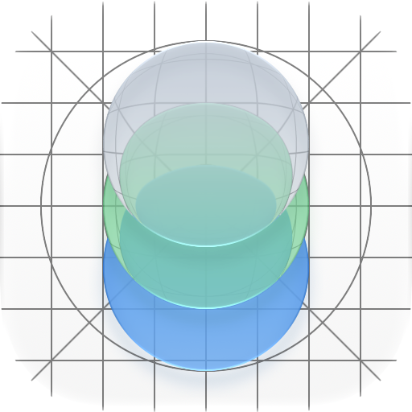

<p align="center"></p>

<h1 align="center">iOS App Starter</h1>

<p align="center">
  <a href="roadmap.md"></a>
  <a href="#current-defaults"></a>
  <a href="#current-defaults"></a>
  <a href="#current-defaults"></a>
  <a href="LICENSE"></a>
</p>

A native iPhone and iPad app to start from. Onboarding, theming and settings are already built as modules: keep the ones you need, delete the rest, and spend your time on what makes your app different. GitHub's Macs build, test and ship it to TestFlight, so you can work from a Mac, from Windows, or let an AI agent do the setup.

## What you get

| Module | What it gives you |
| --- | --- |
| **Onboarding** | A first-launch flow you assemble from steps: welcome, tour cards, a question, a permission prompt, or your own view. Shows once, can be skipped, then hands off to tips. |
| **Theme** | Colors, spacing and text styles in one place, plus buttons and cards that adapt to dark mode and large text. |
| **Settings** | A settings screen with appearance, app info and Keychain-backed secrets. |
| **TabShell** | Native tabs whose screens, labels and symbols you choose in Swift, with remembered selection and count badges. Available by local path until the next module release. |
| **TemplateVersion** | Shows which module version the app was built with. |

Also included:

- **Translations.** Every string is in a string catalog, ready to translate.
- **Accessibility.** VoiceOver, every Dynamic Type size and 44-point touch targets, checked by UI tests.
- **Tests.** Unit tests per module, and UI tests for each feature with screenshots.
- **A placeholder icon** you can personalize with one command.

Planned, as real apps need them: Sign in with Apple, a SwiftData database layer, AI chat (cloud or on-device), and Watch, Mac, TV and Vision Pro. On the backend: a server that holds API keys so the app doesn't have to, and an iMessage bridge. See the [roadmap](roadmap.md).

## Start your app

1. On GitHub, choose **Use this template → Create a new repository**.
2. Name the app in [`project.yml`](project.yml), the single source of truth for the Xcode project:

   | What | Setting in `project.yml` | Example |
   |---|---|---|
   | Home Screen name | `targets.StarterApp.settings.base.INFOPLIST_KEY_CFBundleDisplayName` | `"Pocket Notes"` |
   | Name of development builds | `targets.StarterApp.settings.base.DEV_DISPLAY_NAME` | `"Notes Dev"` |
   | App identifier | `targets.StarterApp.settings.base.PRODUCT_BUNDLE_IDENTIFIER` | `org.example.pocketnotes` |
   | Test identifiers | The same setting under `StarterAppTests` and `StarterAppUITests` | `org.example.pocketnotes.tests` |
   | Minimum iOS | `options.deploymentTarget.iOS` | `"17.0"` |
   | Devices | `targets.StarterApp.settings.base.TARGETED_DEVICE_FAMILY` | `"1,2"` both, `"1"` iPhone, `"2"` iPad |

   Don't rename the `StarterApp` targets or scheme; the Home Screen name is separate.
3. Give it its own icon: `python scripts/personalize-icon.py` ([icon guide](docs/app-icon.md)). To show it at the top of this README, turn on the [README icon sync](docs/ci.md#keep-the-readme-icon-in-sync).
4. Keep only the modules you want: delete a module's product line under `targets.StarterApp.dependencies` and the app still builds.
5. Build your screens in `StarterApp/StarterApp/`. `StarterAppApp.swift` sets up the theme and the onboarding steps; `ContentView.swift` is the welcome screen to replace. Choose your tabs in `StarterTab.swift` and their screens in `StarterTabsView.swift`.

How modules work, how to change one and how to move an app to a tagged version: [docs/modules.md](docs/modules.md).

## Run it

**On a Mac with Xcode 27:** `bash scripts/generate-project.sh`, then open `StarterApp/StarterApp.xcodeproj` and run the `StarterApp` scheme. `bash scripts/test-ios.sh` runs the same UI tests as CI. With your iPhone connected:

```sh
IOS_DEVELOPMENT_TEAM=<your team ID> bash scripts/run-on-device.sh
```

That builds, installs and launches a development build on the phone in about a minute, with no upload. It needs an app identifier your Apple team can sign (step 2); details in [docs/ci.md](docs/ci.md#run-on-your-iphone-from-a-mac).

**From Windows, or anywhere without Xcode:** edit, push and open a pull request. GitHub builds the app on a Mac, runs the tests on a simulator and posts the results with screenshots. Nothing to install.

**On your phone through TestFlight:** once Apple setup is done, one command builds, signs and uploads from `main`:

```sh
python scripts/deliver_testflight.py --configuration starter
```

Apple setup takes an Apple Developer membership and an App Store Connect API key, which stays in GitHub Secrets; [docs/apple-setup.md](docs/apple-setup.md) walks through it, and [docs/testflight-delivery.md](docs/testflight-delivery.md) covers delivery.

## Also handled

- **Failure reports an agent can act on.** A red pull request names the failing test, file and line. [docs/ci.md](docs/ci.md)
- **Older iOS versions.** A weekly run tests the app on every iOS version GitHub's Macs offer, back to iOS 17. [docs/ci.md](docs/ci.md#test-on-older-ios-versions)
- **Tester feedback.** TestFlight feedback can be read from the command line and turned into issues. [docs/tester-feedback.md](docs/tester-feedback.md)
- **A social preview card.** Describe it in `.github/social-preview.json`, then run `python scripts/social-preview.py` on a Mac or the manual **Social preview** workflow from anywhere for a 1280×640 link-preview card with your app's icon and screenshots. [docs/ci.md](docs/ci.md#make-a-social-preview-card)
- **Setup by an AI agent.** An agent can take a fresh copy of this repository to the app on your phone, asking you only for what Apple and GitHub require a person to do. [docs/agent-onboarding.md](docs/agent-onboarding.md)

## Current defaults

| Setting | Value |
|---|---|
| Xcode | 27.0 on GitHub's `xcode-27` runner, with the iOS 27.0 SDK |
| Minimum OS | iOS and iPadOS 17.0 |
| Devices | iPhone and iPad |
| Simulator for required checks | iPhone 17, iOS 27.0 |
| Project generator | XcodeGen 2.46.0 |


## Working on the starter itself

Read [AGENTS.md](AGENTS.md) first. The [roadmap](roadmap.md) holds the agreed decisions and what's next, and the [setup journal](docs/setup-experience.md) records what went wrong along the way and how it was fixed.

## License

MIT; see [LICENSE](LICENSE). The placeholder icon is Apple's Icon Composer demo under Apple's own terms (`third_party/apple-icon-composer-demo/`); replace it before shipping.
